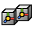
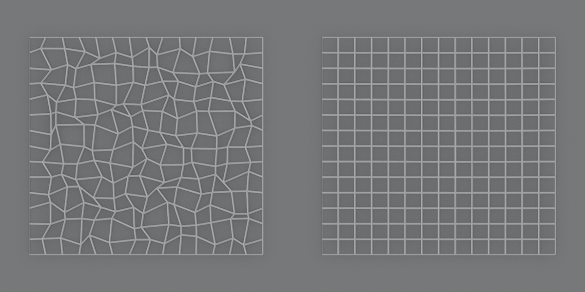
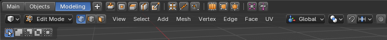

<!--
Keep this document short & concise,
linking to external resources instead of including content in-line.
See 'release/text/readme.html' for the end user read-me.
-->

About this fork
===============

An unofficial fork of Blender 5.1.0 that adds new modifiers, new Geometry Nodes, two new editors and the classic
2.79 look. It isn't made or supported by the Blender Foundation, so please don't report its bugs to the Blender
project.

**[Download for Windows](https://github.com/demircanyigit/blender/releases/latest)**: unzip it and open
`blender.exe`. No installer is needed, and your official Blender keeps working next to it.

Files that use these additions won't work properly in official Blender. See
[what to know before using it](doc/fork/README.md).

## At a glance

| Area | What's new |
|---|---|
| [Modifiers](#modifiers) | 45 new modifiers, a Modifier List view of the stack, viewport gizmos |
| [Geometry Nodes](#geometry-nodes) | 13 new modeling nodes, plus node versions of the new and classic modifiers |
| [Toolbox and Shelf](#toolbox-and-shelf) | Two new editors for your own buttons, and icons in Quick Favorites |
| [Classic look](#classic-look) | Colored 2.79-style icons, embossed widgets, square vertices |
| [Solid shading](#color-attributes-in-solid-shading) | Color attributes mixed into the material color |

## Modifiers

### Modifier List

The Modifiers tab has a second way to show the stack. The button in its header switches between the usual
**Stack** of panels and a **List**:

-   **The list:** one row per modifier, with its icon, name and on/off toggles. Only the active modifier shows its
  settings, under the list, so long stacks stay short.
-  **Show End Result:** when it's off, the viewport shows the stack only up to the active modifier, so you can
  see what each step does without turning the others off.
-   **Order:** the list can show the first modifier on top, or the last one.
-        **Right-click menu:** rename, copy and paste, move, enable or disable, collapse up to here, apply all,
  delete all, and copy the whole stack to the selected objects.
-  **Favorites:** mark the modifiers you use most, and they're listed first when you add one. They're saved in
  your user settings, so every file has them.
- **Add menu:** every mesh modifier in one menu of seven columns: Model, Topology and Smooth, Elements and
  Select and Normals, Deform, Shape, UV and Data, and Physics with Geometry Nodes.

### New modifiers

All 45 work like the built-in ones: they're in the Add Modifier menu with their own icons, they can be applied,
and most of them also work in Edit Mode.

*From left to right: Voronoi Fracture with Exploded View, Poly Select with four Poly Edits, Panelize and Radial
Array.*

**Model and topology**

| | Modifier | What it does |
|---|---|---|
|  | Isotropic Remesh | Rebuilds the mesh out of even, near-equilateral triangles that follow its surface |
|  | QuadriFlow Remesh | Rebuilds the mesh out of quads that follow its shape |
|  | Voronoi Fracture | Cuts a closed mesh into solid pieces, from random points or the points of another object |
|  | Slice | Cuts the mesh with a plane and removes one side, optionally filling the cut |
|  | Cap Holes | Closes the holes of the mesh with new faces |
|  | Face Extrude | Extrudes faces along their normals and scales them |
|  | Inset | Insets faces, each on its own or as one region |
|  | Panelize | Splits the faces into panels with a gap and a chamfer between them |
|  | Poke | Splits each face into a fan of triangles around its center |
|  | Quadrangulate | Joins pairs of triangles into quads |
|  | Beautify Faces | Flips the edges between triangles so they're more even |
|  | Rotate Edges | Turns the edges between faces to connect the other corners |
|  | Symmetrize | Makes one side of the mesh a mirror of the other |
|  | Sweep | Makes a mesh by moving a shape along curves |

**Selection and editing in the stack**

| | Modifier | What it does |
|---|---|---|
|  | Poly Select | Stores a selection of points, edges or faces in the stack, for the modifiers after it |
|  | Poly Edit | Moves, extrudes, insets, pokes or deletes the selected elements |
|  | Volume Select | Writes a vertex group with the points inside a sphere, box or cylinder |
|  | Delete Mesh | Deletes the points, edges or faces picked by a vertex group or an attribute |

Poly Select and Poly Edit work together. Select faces in Edit Mode, store them with Poly Select, then add Poly
Edit above it. The faces Poly Edit makes become the new selection, so another Poly Edit can carry on from them.
Every step stays editable, like a history you can go back and change.

**Elements**

| | Modifier | What it does |
|---|---|---|
|  | Radial Array | Arranges copies of the mesh around an axis |
|  | Exploded View | Pushes faces, islands or other elements apart, with a factor you can animate |
|  | Randomize Elements | Gives each face, island or other element a random rotation, scale, offset, UVs or color |
|  | Element Order | Reorders faces or islands, so Build and other order-based effects run the way you want |
|  | Store Element Pivot | Writes the center and axes of each island or other element to point attributes |

**Deform and shape**

| | Modifier | What it does |
|---|---|---|
|     | Bend, Twist, Taper, Stretch | Deform the mesh around a gizmo axis, with limits |
|    | FFD 2x2x2, 3x3x3, 4x4x4 | Bend the shape with a box of control points that you move in the viewport |
|  | Noise | Moves the points by fractal noise on X, Y and Z, without a texture |
|  | Push | Inflates or shrinks the mesh along its normals |
|  | Melt | Sags the shape and spreads it out toward the ground |
|  | Relax | Evens out the spacing of the points while keeping them on the surface |
|  | Shape Key In-between | Morphs through a sequence of shape keys with one value |

*Bend, Twist, Taper and Noise.*

*A grid with uneven points, and the same grid after Relax.*

**UV, normals and data**

| | Modifier | What it does |
|---|---|---|
|  | UVW Map | Projects a UV map from a planar, cylindrical, spherical or box gizmo |
|  | Smart UV Project | Unwraps the mesh automatically and packs the islands |
|  | Mark by Angle | Marks sharp edges, seams, creases or bevel weights where faces meet at a steep angle |
|  | Material By Element | Gives faces material indices at random, by piece, in order or by direction |
|  | Data Channel | Computes a value per point, such as convexity or edge length, remaps it and writes it out |
|  | Tension | Stores how much the mesh is stretched or squashed compared to its rest shape |

**Curves**

| | Modifier | What it does |
|---|---|---|
|  | Normalize Spline | Respaces the points of the curves evenly |
|  | Relax Spline | Smooths the curves |
|  | Chamfer Spline | Cuts the corners of the curves, straight or rounded |
|  | Spline Morph | Moves the curves toward the curves of another object |

### Viewport gizmos

The active modifier can be edited in the viewport:

- **Bend, Twist, Taper, Stretch, UVW Map, Volume Select and Radial Array:** a handle moves the center, a dial
  sets the angle, and arrows set the limits.
- **Slice:** a handle for the plane and an arrow for its distance.
- **FFD:** a handle on every control point, with the cage drawn between them.

They follow the viewport's Gizmos ▸ Modifier toggle.

## Geometry Nodes

These are real nodes for the Geometry Nodes editor, not add-ons or node groups.

### Node versions of the modifiers

Most of the new modifiers are also nodes that share the same code, so a node tree and a modifier give the same
result: Cap Holes, Face Extrude, Inset, Panelize, Poke, Quadrangulate, Beautify Faces, Rotate Edges, Symmetrize,
Radial Array, Exploded View, Randomize Elements, Element Order, Element Pivot, Bend, Twist, Taper, Stretch, FFD,
Noise, Push, Melt, UVW Map, Smart UV Project, Mark by Angle, Material By Element, Data Channel, Mesh Tension,
Volume Select, Morph Curves and Relax Curves.

The classic modifiers that had no node now have one too: Array, Build, Cast, Curve Deform, Edge Split, Lattice
Deform, Laplacian Smooth, Mirror, Normal Edit, Remesh, Screw, Shrinkwrap, Simple Deform, Skin, Smooth, Solidify,
UV Warp, Warp, Wave, Weighted Normal and Wireframe.

### The first thirteen nodes

Add them with **Add ▸ Mesh ▸ Operations**, or **Add ▸ Curve ▸ Operations** for Sweep.

#### Isotropic Remesh

Rebuilds a mesh out of even, near-equilateral triangles that follow the original surface. Hard Edges keeps the
edges you choose, like the eye and mouth rims here.

- **Modes:** Uniform uses one edge length, and zero uses the input's average. Adaptive uses shorter edges where
  the surface curves, between a Min and Max Edge Length and within a Tolerance.
- **What to keep:** Preserve Boundary keeps open edges in place, and Preserve Sharp Edges keeps edges above a
  Sharp Angle. Hard Edges is a field, so it can take the `sharp_edge` attribute or an Edge Angle comparison.
- **Attributes:** point, face and corner attributes such as UVs are sampled from the nearest surface. Edge
  attributes are lost because every edge is new.

#### Decimate Mesh

Reduces triangles where it changes the surface the least, so flat areas lose detail before curved ones. The
result is triangles.

- **Target:** Ratio keeps a fraction of the selected vertices, and Face Count aims for a number of triangles.
- **Limits:** Max Error, Max Normal Change and Max Aspect Ratio protect quality and can stop it before the
  target. Set any of them to zero to turn it off.
- **What to keep:** Selection picks which vertices may be removed. Preserve Boundary and the Hard Edges field
  protect open edges and the edges you choose.

#### Voronoi Fracture

Cuts a closed mesh into solid pieces around the points you give it, with the cut faces filled in. More points
in an area make smaller pieces there.

- **Inputs:** Cell Points takes any geometry with points, Cut Gap leaves space between the pieces, and Separate
  Islands splits parts of a cell that aren't connected.
- **Outputs:** Piece Index numbers the pieces, for example for Split to Instances. Cell Index tells you which
  point made each piece. Interior selects the cut faces, which is how the orange material is set here.
- **Good to know:** the mesh has to be closed. The pieces stay in place until you move them, as in the picture
  on the right.

#### Bevel

The Bevel modifier as a node, using the same code. It gave the same result as the modifier in every setting
compared. Unlike the modifier, Amount and Weight can differ per edge or vertex, for example from Random Value.

- **Inputs:** Affect picks Edges or Vertices. Width Type, Segments and Shape work as in the modifier. Selection
  picks what to bevel, and Angle skips edges flatter than a limit.
- **Geometry and Shading panels:** miters, Spread, Intersections, Clamp Overlap, Loop Slide, Harden Normals, Mark
  Seam, Mark Sharp and Material Index.
- **Output:** Bevel Faces selects the new faces, for example to give them their own material.
- **Good to know:** only edges with exactly two faces get beveled. There's no custom profile or Face Strength
  yet. Segments, Shape and Spread are one value for the whole mesh.

#### Sweep

Sweeps a shape along curves, inspired by Houdini's Sweep. It gives the same surface as Curve to Mesh where the two
overlap, but needs no extra nodes for the shape and also makes UVs.

- **Shapes:** Round Tube, Square Tube, Ribbon, or your own curves in Cross Section. Columns sets the number of
  faces around the built-in shapes.
- **Per curve point:** Scale, Roll and Twist are fields. Twist grows from nothing at the start of the curve to
  the full angle at its end.
- **Outputs:** UV Map follows the shape and the curve, with Length Based UVs keeping faces in proportion. Caps
  selects the end faces made by Fill Caps.
- **Good to know:** caps are flat. Every cross section is swept along every curve. Twist needs enough curve
  points to show, so put Resample Curve in front of a two-point line.

#### Resample Mesh

Adds points along edges without changing the shape or the number of faces, inspired by Houdini's Resample.

- **Modes:** Length sets the distance between points, and Count sets the segments on each edge. Both are fields, so
  they can differ per edge. Selection picks which edges change.
- **Output:** New Points selects the added points, for example to place instances on them.
- **Attributes:** point and corner attributes such as colors and UVs are interpolated onto the new points, and
  shared points stay welded.
- **Good to know:** edges stay straight, so curved surfaces don't get smoother. Faces become n-gons with extra
  points, so add Triangulate if you need triangles.

#### Clip

Cuts a mesh with a plane and removes one side, inspired by Houdini's Clip. The cut can be filled, and rings keep
their hole.

- **Plane:** Origin, Direction and Distance set the plane. Space picks whether it moves with the object or stays
  in place in the world.
- **Keep:** Above, Below, or Both to only add the cut to the surface.
- **Outputs:** Interior selects the fill faces, like the orange ones here, and Cut Edges selects the edges along
  the cut, for example to bevel them.
- **Good to know:** only closed loops can be filled, so cutting an open mesh may leave parts of the cut open.

#### Dice

Cuts a mesh into a grid of pieces along its bounding box. Pick a count on X, Y and Z, or a cell size, and you're
done. It doesn't need points like Voronoi Fracture, and it also works on open meshes.

- **Grid:** Count X, Y and Z, or Size in Size mode. Space uses the bounding box and axes of the object or of the
  world, so the cuts can stay straight when the object rotates.
- **Options:** Cut Gap leaves space between the pieces, Fill Cuts makes them solid, and Separate Islands splits
  parts of a cell that aren't connected.
- **Outputs:** Piece Index numbers the pieces, for example for Split to Instances. Cell Index is the position in
  the grid. Interior selects the fill faces.
- **Good to know:** each mesh uses its own bounding box, so add Realize Instances in front to dice instances
  together. Pieces at the edge of a curved shape can be very small.

#### Dissolve

Removes parts of a mesh and merges the faces around them instead of leaving holes, using the same code as
Dissolve in Edit Mode.

- **Modes:** Vertices, Edges and Faces use the Selection field. Limited removes edges and points where the surface
  stays nearly flat, below an Angle.
- **Options:** Remove Inline Points cleans up points left between two edges. In Limited mode, the Keep panel stops
  merging across materials, seams, sharp edges or UVs.
- **Output:** Merged Faces selects the faces that were made, except in Vertices mode.
- **Good to know:** merged faces can be n-gons that aren't flat, which can shade unevenly.

#### Smooth

Smooths a surface by moving points toward their neighbors. Topology and attributes stay the same.

- **Methods:** Average is strong, but the mesh shrinks with more iterations. Keep Volume mostly keeps the size, but
  only removes small bumps, so big shapes stay.
- **Control:** Factor and Selection are fields, so strength can differ per point. Preserve Boundary and the Hard
  Edges field keep those points in place.

#### Relax

Evens out the distances between points by sliding them along the surface, so the shape stays the same.

- **Control:** Factor and Selection are fields, Iterations sets the number of passes, and Keep on Surface moves
  points back onto the original surface after each pass.
- **What to keep:** Preserve Boundary and the Hard Edges field keep those points in place.
- **Good to know:** it doesn't change how points are connected, so uneven topology like the poles of a UV sphere
  stays uneven. Isotropic Remesh does that.

#### QuadriFlow Remesh

Rebuilds a mesh out of quads that follow the flow of its surface, using the same code as the QuadriFlow option of
the Remesh operator, but as a node you can keep changing.

- **Target:** Face Count, a Ratio of the input's faces, or an Edge Length. The result is only close to the target.
- **Options:** Seed changes the layout of the quads. Preserve Sharp and Preserve Boundary try to follow sharp
  features and open boundaries.
- **Attributes:** attributes and materials carry over, copied from the nearest part of the input.
- **Good to know:** the mesh must be manifold, or the node shows an error and leaves it as it is. Details smaller
  than the quads get crumpled or lost. It's slow and runs again when anything before it changes, so bake it or use a
  low target while working.

#### Displace

Moves points by a height or a vector, like the Displace modifier, but you connect any texture or field directly.
Without a texture it gives the same result as the modifier.

- **Modes:** Normal moves along each point's normal, Direction along a direction, and Vector by a vector, for
  example from the color of a texture.
- **Per point:** Height, Direction, Vector, Strength and Selection are fields. Midlevel sets the value that doesn't
  move a point, so 0.5 pushes points both ways.
- **Good to know:** the mesh needs enough points to show detail, so subdivide it first if needed. Direction and
  Vector are relative to the object.

## Toolbox and Shelf

Two new editors hold buttons you pick yourself. Choose them from any area's Editor Type menu.

###  Toolbox

A column of large buttons in sections, with tabs down the right side.

- **Adding buttons:** right-click any button in Blender and choose **Add to Toolbox**.
- **Arranging:** add, rename, move and remove tabs, sections, separators and buttons from the right-click menu.
  Each button can have its own name and icon.
- **Two styles:** a grid of icons, or a list with one named button per row.
- **Default tabs:** it starts with the modifiers and modeling tools in tabs. **Restore Default Tab** and
  **Reset Toolbox to Default** bring them back.

The contents are saved in `toolbox.json` in your user settings, so they're the same in every file.

###  Shelf

A thin strip of icon buttons. It's an editor of its own, and also a strip at the top of the 3D Viewport that you
toggle with **Alt Y**.

-   **Adding buttons:** right-click any button and choose **Add to Shelf**, or **Remove from Shelf**.
- **Icon size:** small, medium, large or a custom scale, in the shelf's header.
- **Starter presets:** Modeling, Modifiers and Objects.

The buttons are saved in your preferences, so every shelf shows the same ones.

### Quick Favorites with icons

Items in Quick Favorites (**Q**) show their icons. The icon is picked automatically when you add an item.

## Classic look

The fork brings back the Blender 2.79 look:

- **Colored icons:** more than 600 new icons drawn in the 2.79 style. Every Geometry Node and every new modifier
  has one, and so do the tools and many operators, such as the Merge, Parent, Select Similar and import and
  export menus.
- **Emboss:** buttons, menus, tooltips, panel headers, tabs and nodes have a light top edge and a dark bottom
  edge. Each widget style in **Preferences ▸ Themes ▸ User Interface** has a **Bevel** setting for its strength.
- **Node headers:** a gradient from left to right.
- **Vertices:** square, like in 2.79.
- **Keyframes:** shaded as if lit from the top left.

More in [the classic look notes](doc/fork/CLASSIC_UI.md).

## Color attributes in Solid shading

Each material can combine its viewport color with a color attribute, so you can check vertex color variation
without leaving Solid mode. You'll find it under Material ▸ Viewport Display, with the viewport's Color set to
Material.

- **Options:** None, Mix, Multiply, Two Colors and Color Ramp. Mix isn't in the picture.
- **Settings:** Factor sets the strength. Two Colors and Color Ramp can read Brightness, Red, Green, Blue or Alpha.
- **Good to know:** it only changes the viewport, not renders, and only applies to meshes.

## More

- [What to know before using it](doc/fork/README.md)
- [All node inputs and limits](doc/fork/NODES.md)
- [Material options](doc/fork/VIEWPORT_COLORS.md)
- [The classic look](doc/fork/CLASSIC_UI.md)
- [Building on Windows](doc/fork/BUILD_WINDOWS.md)

The rest of this page is Blender's own read-me.

Blender
=======

Blender is the free and open source 3D creation suite.
It supports the entirety of the 3D pipeline—modeling, rigging, animation, simulation, rendering, compositing,
motion tracking and video editing.

Project Pages
-------------

- [Main Website](http://www.blender.org)
- [Reference Manual](https://docs.blender.org/manual/en/latest/index.html)
- [User Community](https://www.blender.org/community/)

Development
-----------

- [Build Instructions](https://developer.blender.org/docs/handbook/building_blender/)
- [Code Review & Bug Tracker](https://projects.blender.org)
- [Developer Forum](https://devtalk.blender.org)
- [Developer Documentation](https://developer.blender.org/docs/)

License
-------

Blender as a whole is licensed under the GNU General Public License, Version 3.
Individual files may have a different but compatible license.

See [blender.org/about/license](https://www.blender.org/about/license) for details.
