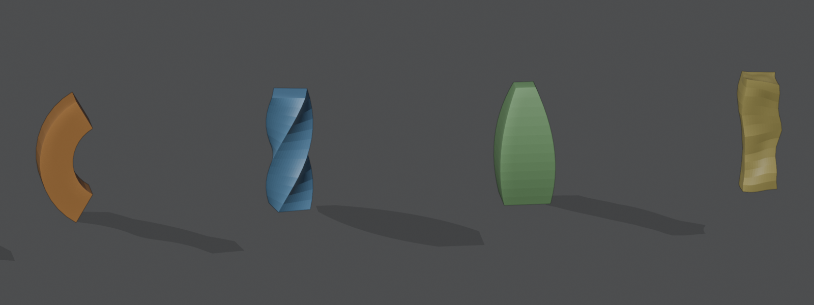

# Bend, Twist, Taper and Stretch

   

Four modifiers that change the shape along an axis, each with its own gizmo that you can move and
turn. They do what the Simple Deform modifier does, but each is a modifier of its own with clearer
settings, a **Direction** for Bend, and limits you can set in the viewport.

- **Bend** bends the mesh around the gizmo.
- **Twist** twists it around the gizmo's axis.
- **Taper** makes it bigger toward one end, with an optional bulge.
- **Stretch** makes it longer along the axis and thinner in the middle.



*Bend, Twist, Taper and Noise.*

Add it from **Add Modifier ▸ Deform**. It works on meshes, curves, surfaces and text. In the [Modifier List](MODIFIER_LIST.md)'s Add menu it's in the **Shape** column.

## Settings

**Bend**

- **Angle**: Total angle of the bend.
- **Direction**: Side to bend toward, around the axis.

**Twist**

- **Angle**: Total angle of the twist.

**Taper**

- **Amount**: How much bigger the top is than the center.
- **Curve**: Bulge of the sides.

**Stretch**

- **Stretch**: How much longer the mesh gets along the axis.
- **Amplify**: How much thinner the middle gets as it stretches.

**All four**

- **Axis**: Gizmo axis along which the shape changes: X, Y or Z.
- **Center**: Center of the gizmo, in object space.
- **Rotation**: Rotation of the gizmo.
- **Limit Effect**: Only change the part between the limits, and carry the rest along.
- **Lower Limit**: Lower limit along the axis, from the center.
- **Upper Limit**: Upper limit along the axis, from the center.
- **Vertex Group**: Vertex group that controls how much each point is affected.

## In the viewport

When one of them is the active modifier, a handle moves the center of the gizmo, a dial sets the
angle of Bend and Twist, and with **Limit Effect** on, markers set the limits with a line between
them. See [Modifier gizmos](MODIFIER_GIZMOS.md).

## As a node

Geometry Nodes has **Bend**, **Twist**, **Taper** and **Stretch** nodes that share their code with these modifiers.

## In Python

```python
mod = obj.modifiers.new("Bend", 'BEND')
mod = obj.modifiers.new("Twist", 'TWIST')
mod = obj.modifiers.new("Taper", 'TAPER')
mod = obj.modifiers.new("Stretch", 'STRETCH')
```

The Python types are `BendModifier`, `TwistModifier`, `TaperModifier` and `StretchModifier`. Official Blender doesn't know these modifiers, so a file that uses them won't give the same result there.
