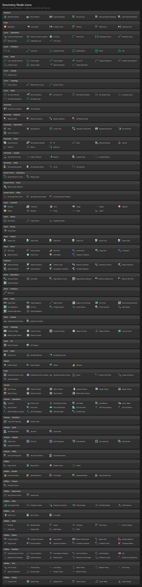

# Classic look

The fork brings back parts of the Blender 2.79 look: colored icons and embossed widgets.

## Geometry Node icons

Every node in the Geometry Nodes Add menu has an icon, and so do the menu's categories. 47 nodes
that do a modeling operation use that operation's icon, recolored. The other 287 have their own,
drawn in the 2.79 style:

The icons are named `GEO_N_` and the node's name, for example `GEO_N_INPUT_INDEX` for the Index
node. They are listed in `UI_icons.hh`, and `set_geometry_node_icons()` in `node_register.cc`
gives each node its icon.

Like the other classic icons, they are colored images in the `icons_classic` data-files folder,
which is not in this repository. Builds from the Releases page include it; without it they draw
blank.

## Emboss

Buttons, menus, tooltips, panel headers, tabs and nodes have a light top edge and a dark bottom
edge. Widgets that are shaded darker at the top, like number and text fields, look sunken instead.

Each widget style in **Preferences ▸ Themes ▸ User Interface** has a **Bevel** setting from 0 to
100 for its strength. Panel headers and node bodies use the Box style's bevel, region tabs use the
Tab style's, and node headers use the Regular style's along with a left to right gradient from its
shading.

Preferences from before this setting get the default theme's bevel once.
