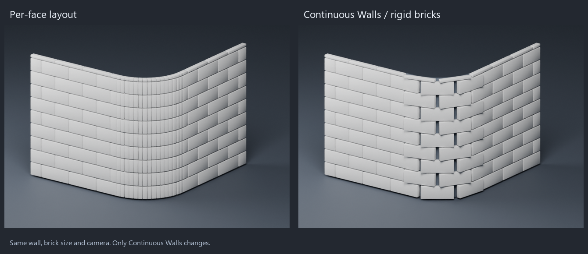

# Masonry


Covers faces with brick, stone or paving blocks: 20 patterns from running bond and Flemish to
herringbone, cobblestone, flagstone and fans. The blocks stick out of the
face, with mortar joints between them. Random length, height, depth, tilt and shape break up the
pattern, and the blocks and mortar can get their own materials.

For whole stones stacked into a solid wall, see [Stonework](STONEWORK.md). For boards, see
[Planks](PLANKS.md).

Add it from **Add Modifier ▸ Generate**. It works on meshes. In the [Modifier List](MODIFIER_LIST.md)'s
Add menu it's in the **Build** column.

## Settings

- **Pattern**: How the blocks are laid.
  - **Running**: Each row shifted by half a brick.
  - **Stack**: Bricks right on top of each other.
  - **Flemish**: Long and short bricks taking turns in each row.
  - **English**: Rows of long bricks and rows of short bricks taking turns.
  - **Ashlar**: Cut stones of mixed sizes in rows.
  - **Ledgestone**: Thin, long stones in rows.
  - **Rubble**: Uneven stones of mixed shapes.
  - **Herringbone**: Bricks in a zigzag, each at a right angle to the next.
  - **Chevron**: Rows of slanted bricks meeting in V shapes.
  - **Basket Weave**: Squares of bricks laid across and along in turns.
  - **Pinwheel**: Four bricks around a small square.
  - **Versailles**: Squares and rectangles of four sizes.
  - **Hexagon**: Six-sided tiles.
  - **Octagon**: Eight-sided tiles with small squares between them.
  - **Diamond**: Diamond-shaped tiles.
  - **Interlocking**: Pavers with wavy sides that fit into each other.
  - **Cobblestone**: Small stones with cut corners in rough rows.
  - **Flagstone**: Large flat stones of uneven shapes.
  - **Fan**: Stones laid in fan-shaped arcs.
  - **Radial**: Rings of stones around a center.
- **Direction**: Which way the rows run.
  - **Auto**: Level rows on walls, along X on floors.
  - **X**: Rows along X.
  - **Y**: Rows along Y.
  - **Face**: Rows along the longest edge of each face.
- **Angle**: Turn the pattern on the face.
- **Length**: Size of a block along the rows.
- **Height**: Size of a block across the rows.
- **Depth**: How far the blocks stick out of the face.
- **Mortar**: Width of the joints between the blocks.
- **Offset**: 0 puts the blocks on the face, 1 sinks them in so their tops are at the face.
- **Backing**: Keep the faces under the blocks, to show as mortar.
- **Border**: A row of blocks along the outline of each face. Only on convex faces.
- **Toothed**: Blocks at the edges of a face stick out whole instead of being cut.
- **Continuous Walls**: Continue wall patterns across vertical faces with rigid bricks; Auto direction only. Sharp edges and corners of 45 degrees or more break the layout.
- **Soldier Rows**: After this many rows, a row of upright bricks. 0 for none.
- **Center**: Center of the fans or rings. Without one, the middle of the mesh.
- **Random Length**: Change the length of each block.
- **Random Height**: Change the height of each row.
- **Random Depth**: Change how far each block sticks out.
- **Tilt**: Largest random tilt of a block.
- **Stone Shape**: Make the outlines of the blocks uneven.
- **Dome**: Round the tops of the blocks.
- **Seed**: Changes the random values.
- **Vertex Group**: Only faces with all their points in this group get blocks.
- **Materials**: Give the blocks and the mortar their own materials.
- **Block Material**: Material index of the blocks.
- **Mortar Material**: Material index of the faces under the blocks.

Small blocks on big faces make a lot of geometry, so start with a few faces.

## Continuous walls

Enable **Masonry > Options > Continuous Walls** to continue a brick layout across the narrow
vertical faces of a beveled wall. In Geometry Nodes, enable the **Continuous Walls** input.
The option starts disabled so existing files retain their previous result.



This mode measures distance along connected walls, lays out the pattern once, and places each
brick as one rigid solid. The internal edges of the input mesh no longer cut bricks into strips.
Bricks follow the wall direction at their centers; they do not bend across the curve.

### Supported surfaces

- Vertical walls, including straight subdivided walls and rounded vertical corners.
- **Auto** direction with Running, Stack, Flemish, English, Ashlar, Ledgestone or Rubble patterns.
- Pattern rotation, depth variation, tilt, borders, toothed boundaries, materials and selection.
- Closed round walls get a layout seam where their unfolded ends meet.

Marked **Sharp** edges, non-manifold edges, selection boundaries and corners turning 45 degrees
or more break the continuous layout. Mark a vertical edge sharp to deliberately end a wall strip.
These are geometric edge markings; changing smooth shading alone does not mark an edge sharp.

The unfolded boundary must be one convex outline. Sloped surfaces, concave outlines and walls
with openings or branching boundaries keep the original per-face behavior. This fallback avoids
filling openings or creating bricks across ambiguous surfaces.

### What to expect

Increasing the number of bevel segments should improve the wall approximation without producing
additional rows of thin brick fragments. Partial bricks still occur at actual layout boundaries.
Long rigid bricks on a tight curve can leave space behind their ends and wider wedge-shaped joints.
Use a shorter brick length or a larger corner radius when appropriate. Rigid bricks approximate
the curve with flat faces; this mode does not produce curved or tapered bricks.

The original mesh stays unchanged.

### Regression checks

```bat
blender.exe -b --factory-startup --python-exit-code 1 --python tests/python/bl_masonry_continuous.py
```

The suite checks subdivision-independent brick counts, bevel-segment fragmentation, sharp breaks,
right-angle breaks, round-wall seams, closed brick meshes, and modifier/node agreement.

## As a node

Geometry Nodes has a **Masonry** node that shares its code with this modifier. It can also use a
custom tile. See [NODES.md](NODES.md#masonry).

## In Python

```python
mod = obj.modifiers.new("Masonry", 'MASONRY')
```

The Python type is `MasonryModifier`. Official Blender doesn't know this modifier, so a file that
uses it won't give the same result there.
