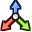

# Modifier gizmos

Some of the new modifiers can be edited right in the 3D Viewport. Make the modifier the active one
in the Modifiers tab, and its handles appear on the object, in Object and Edit Mode.

| Modifier | Handles |
|---|---|
| [Bend](BEND_TWIST_TAPER_STRETCH.md) | A handle moves the center, a dial sets the angle in the bend plane, and with Limit Effect on, two markers set the limits |
| [Twist](BEND_TWIST_TAPER_STRETCH.md) | A handle moves the center, a dial sets the angle, and markers set the limits |
| [Taper](BEND_TWIST_TAPER_STRETCH.md), [Stretch](BEND_TWIST_TAPER_STRETCH.md) | A handle moves the center, and markers set the limits |
| [Radial Array](RADIAL_ARRAY.md) | A handle moves the center, and a dial sets the angle |
| [UVW Map](UVW_MAP.md), [Volume Select](VOLUME_SELECT.md) | A handle moves the center |
| [Slice](SLICE.md) | A handle moves the plane, and a marker sets its distance |
| [FFD](FFD.md) | A dot on every control point, with the cage drawn between them |

## Using them

- **Handles** (the circles) move in the plane of the screen. Drag them like any other gizmo.
- **Dials** turn the angle. The angle is shown while you drag.
- **Limit markers** sit right at the lower and upper limit, point away from the center, and have a
  line between them, so you can see which part of the mesh is changed.
- **FFD dots** move one control point each. The cage stays drawn while you drag, so you see the
  shape change. **Reset Points** in the modifier puts them all back.

The markers follow the object's scale, so a limit of 1 is always 1 unit
of the object's own space, however the object is scaled.

## Showing and hiding

The gizmos follow the viewport's **Gizmos ▸ Active Modifier** toggle. The gizmo button under the
[Modifier List](MODIFIER_LIST.md) turns them on and off in every 3D Viewport at once.
