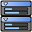
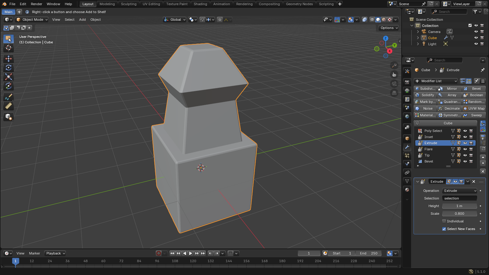
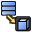
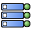
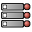
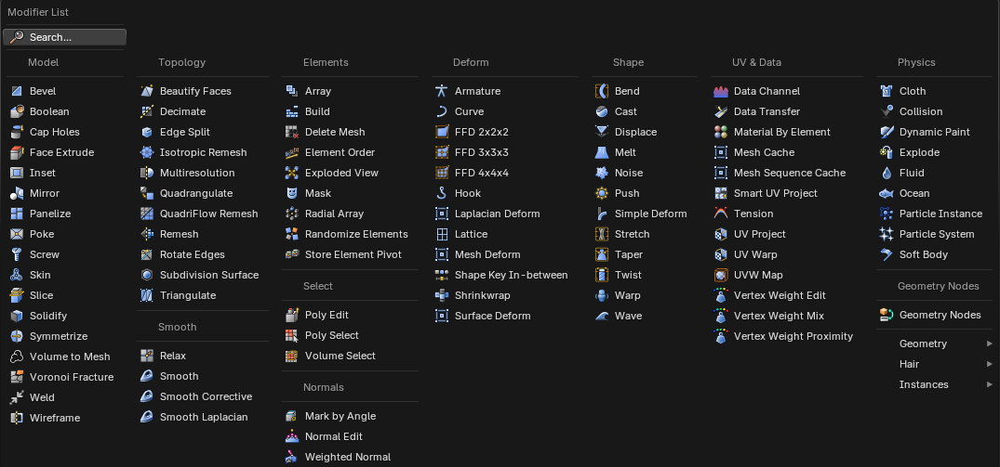

# Modifier List

 

The Modifiers tab has a second way to show the stack: a **List** with one row per modifier, and the
settings of only the active modifier under it. Long stacks stay short, and you can see the whole
stack at a glance.



## Switching

The two buttons in the header of the Modifiers tab switch between the usual **Stack** of panels and
the **List**. The choice is kept per Properties editor.

## The list

- Each row has the modifier's icon and name, and its switches: Edit Mode, On Cage, viewport and
  render. A switch that is off is faded, and a modifier that is off in the viewport and in renders
  is faded as a whole.
- Double-click a name to rename it.
- The row with the mesh's name is the base mesh, at the start of the stack. Click it to go in and
  out of Edit Mode.

## The buttons under the list

Two rows of buttons work on the active modifier and the list:

| | Button | What it does |
|---|---|---|
|  | Apply | Applies the active modifier |
| | Duplicate | Makes a copy of the active modifier |
|  | Copy to Selected | Copies the active modifier to the selected objects |
| | Pin to Last | Keeps the modifier at the end of the stack |
|  | Show End Result | When it's off, the viewport shows the stack only up to the active modifier, so you can see what each step does without turning the others off |
|  | Modifier Gizmos | Shows or hides the [modifier gizmos](MODIFIER_GIZMOS.md) in the 3D Viewports |
|  | Collapse To | Applies every modifier up to the active one |
| | Move Up, Move Down, Delete | Move or delete the active modifier |

## Right-click menu

Right-click a row for: Collapse To, Apply, Duplicate, Copy and Paste, Copy to Selected, Enable or
Disable, Rename and Delete.

| | |
|---|---|
|   | **Copy** and **Paste** a modifier between objects, with all its settings |
|  | **Rename** the modifier |

## Options menu

The menu button in the header has:

| | |
|---|---|
|   | **First on Top** or **Last on Top**: the order of the list |
|   | **Enable All** and **Disable All** in the viewport |
|  | **Apply All** modifiers |
|  | **Delete All** modifiers |
|  | **Copy Stack to Selected**: give the selected objects the whole stack |
|  | **Favourites...**: see below |

## Adding modifiers

**Add Modifier** above the list opens every mesh modifier in one menu of columns: Edit, Build,
Topology, Elements, Deform and Shape on top, and Smooth, Normals, UV, Data, Select and Physics
under them. The search button next to it finds a modifier by name.



## Favourites

Your favourite modifiers are buttons above **Add Modifier**: click one to add that modifier. The
Favourites button next to the search button, or **Favourites...** in the options menu, sets them up:
click a modifier to add it or remove it, move them up and down, and choose one to three columns.
**Reset to Default** brings back the starting set.

Favourites are saved in your user settings, so every file has them.

## In Python

```python
space = bpy.context.space_data        # a Properties editor
space.use_modifier_list = True        # False for the Stack
```
