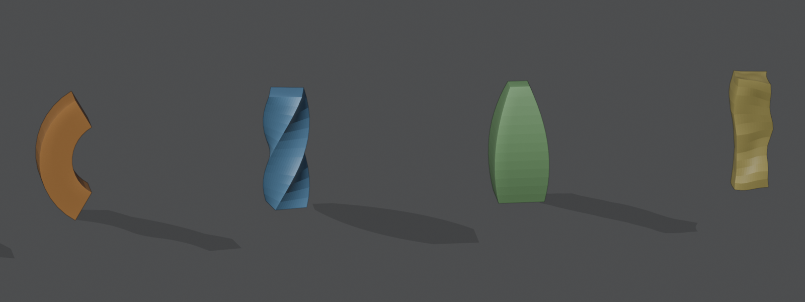

# Noise


Moves the points by a fractal noise on X, Y and Z, without making a texture first like the Displace
modifier needs. Animate **Phase** for wobbling motion.



*Bend, Twist, Taper and Noise.*

Add it from **Add Modifier ▸ Deform**. It works on meshes, curves, surfaces and text. In the [Modifier List](MODIFIER_LIST.md)'s Add menu it's in the **Shape** column.

## Settings

- **Strength**: Largest move on X, Y and Z.
- **Scale**: Size of the noise pattern.
- **Phase**: Moves through the noise. Animate it for motion.
- **Fractal**: Add finer layers of noise.
- **Detail**: Number of finer layers.
- **Roughness**: Strength of the finer layers.
- **Lacunarity**: How much finer each layer is.
- **Seed**: Change it for a different noise.
- **Vertex Group**: Vertex group that controls how much each point is affected.

## As a node

Geometry Nodes has a **Noise Deform** node that shares its code with this modifier, so a node tree and the modifier give the same result.

## In Python

```python
mod = obj.modifiers.new("Noise", 'NOISE')
```

The Python type is `NoiseModifier`. Official Blender doesn't know this modifier, so a file that uses it won't give the same result there.
