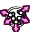

# Normal Shape



Points the shading normals as if the mesh were a simple shape around it. The classic trick for
soft-looking tree crowns, bushes and stylized hair: many leaf cards shade like one smooth ball
instead of a mess of small planes.

Add it from **Add Modifier ▸ Normals**. It works on meshes. In the
[Modifier List](MODIFIER_LIST.md)'s Add menu it's in the **Normals** column.

## Settings

- **Shape**:
  - **Sphere**: points away from the middle.
  - **Cylinder**: points away from a line through the middle, along the **Axis**. Good for
    trunks and tall grass clumps.
  - **Box**: points out of the sides of a box with rounded corners.
- **Center**: an object whose location is the middle of the shape. Empty uses the middle of the
  mesh.
- **Factor**: how much of the shape's normals to use. Lower values keep some of the mesh's own
  shading.
- **Vertex Group**: only change the points in this group, by their weight. **Invert** swaps the
  weights.

The shape fits the bounds of the mesh, so a flat or long mesh gets a squashed sphere or box.

## Flat faces

Shading normals don't show on flat faces. Faces the modifier changes are made smooth. Flat faces it
doesn't change stay flat.

## In Python

```python
mod = obj.modifiers.new("Normal Shape", 'NORMAL_SHAPE')
mod.shape = 'SPHERE'
mod.factor = 0.8
```

The Python type is `NormalShapeModifier`. Official Blender doesn't know this modifier, so a file
that uses it won't give the same result there.
