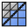

# QuadriFlow Remesh



Rebuilds the mesh out of quads that follow the flow of its shape, like **QuadriFlow Remesh** in the
Object Data properties, but as a modifier you can keep in the stack and change later.

The input should be a closed, manifold mesh. The number of quads is only close to the one you ask
for. Big meshes take a while, so keep the modifier off in the viewport while you work on what's
below it.

Add it from **Add Modifier ▸ Generate**. It works on meshes. In the [Modifier List](MODIFIER_LIST.md)'s Add menu it's in the **Topology** column.

## Settings

- **Target**: What decides the number of quads.
  - **Face Count**: Aim for a number of quads.
  - **Ratio**: Aim for a number of quads relative to the number of faces in the input.
  - **Edge Length**: Aim for quads with edges of this length.
- **Face Count**: Desired number of quads. The result is only close to this.
- **Ratio**: Desired number of quads as a fraction of the number of input faces.
- **Edge Length**: Desired length of the edges of the quads.
- **Seed**: Number that changes the layout of the quads.
- **Preserve Sharp**: Try to follow the sharp features of the surface.
- **Preserve Boundary**: Try to follow the open boundaries of the mesh.
- **Smooth Shading**: Output faces with smooth shading rather than flat shaded.

## As a node

Geometry Nodes has a **QuadriFlow Remesh** node too, described in [Modeling nodes in detail](../../README.md#quadriflow-remesh).

## In Python

```python
mod = obj.modifiers.new("QuadriFlow Remesh", 'QUADRIFLOW_REMESH')
```

The Python type is `QuadriflowRemeshModifier`. Official Blender doesn't know this modifier, so a file that uses it won't give the same result there.
