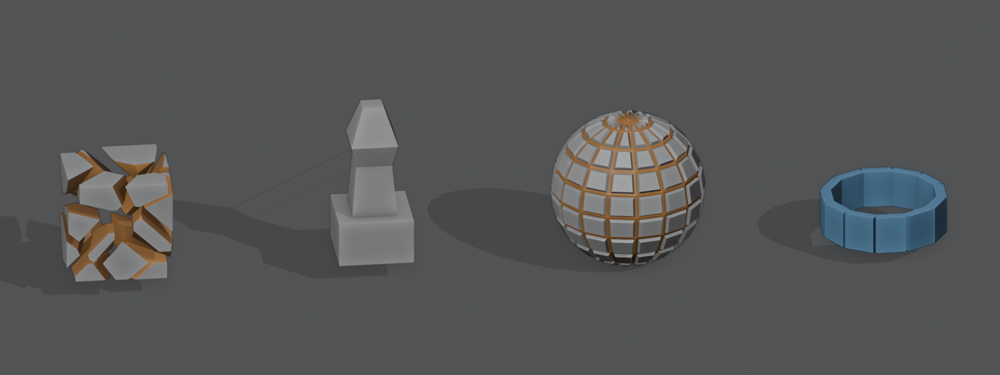

# Radial Array


Arranges copies of the mesh around an axis, for wheels, flowers, columns around a center or spiral
stairs, without an empty object like the Array modifier needs. With **Step**, each copy also moves
along the axis, for a spiral.



*Radial Array is on the right.*

Add it from **Add Modifier ▸ Generate**. It works on meshes. In the [Modifier List](MODIFIER_LIST.md)'s Add menu it's in the **Elements** column.

## Settings

- **Count**: Number of copies, including the original.
- **Angle**: Angle the copies are spread over.
- **Axis**: Axis the copies turn around: X, Y or Z.
- **Center**: Point the axis goes through, in object space.
- **Radius**: Move each copy away from the axis.
- **Step**: Move each copy along the axis by this much more than the one before, for a spiral.
- **Rotate Copies**: Turn the copies to face out from the axis, rather than only moving them.
- **Merge**: Merge points of the copies that touch.
- **Merge Distance**: Points closer than this are merged.

## In the viewport

When Radial Array is the active modifier, a handle moves the center and a dial sets the angle. See
[Modifier gizmos](MODIFIER_GIZMOS.md).

## As a node

Geometry Nodes has a **Radial Array** node that shares its code with this modifier, so a node tree and the modifier give the same result.

## In Python

```python
mod = obj.modifiers.new("Radial Array", 'RADIAL_ARRAY')
```

The Python type is `RadialArrayModifier`. Official Blender doesn't know this modifier, so a file that uses it won't give the same result there.
