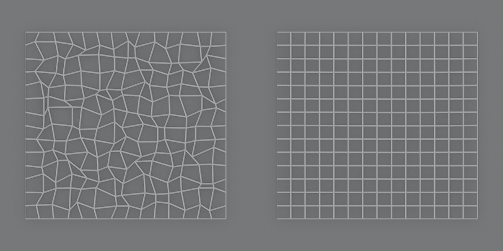

# Relax


Evens out the spacing of the points. With **Keep on Surface**, the points slide along the surface
instead of moving off it, so the shape doesn't shrink the way it does with Smooth. Use it after
sculpting, decimating or projecting to get even faces again.



*A grid with uneven points, and the same grid after Relax.*

Add it from **Add Modifier ▸ Deform**. It works on meshes. In the [Modifier List](MODIFIER_LIST.md)'s Add menu it's in the **Smooth** column.

## Settings

- **Factor**: How far each point moves in one iteration.
- **Iterations**: Number of relax passes.
- **Keep on Surface**: Move the points back onto the original surface after every iteration.
- **Preserve Boundary**: Keep the points on open boundaries in place.
- **Keep Sharp Edges**: Keep the points of sharp edges in place.
- **Vertex Group**: Scales the factor, points outside the group don't move.

## As a node

Geometry Nodes has a **Relax** node too, described in [Modeling nodes in detail](../../README.md#relax).

## In Python

```python
mod = obj.modifiers.new("Relax", 'RELAX')
```

The Python type is `RelaxModifier`. Official Blender doesn't know this modifier, so a file that uses it won't give the same result there.
