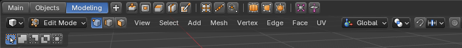
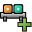

# Shelf

A thin strip of icon buttons that you pick yourself. It's an editor of its own, which you choose from
any area's Editor Type menu, and also a strip at the top of the 3D Viewport that you toggle with
**Alt Y**.

## Adding and removing buttons

| | |
|---|---|
|  | Right-click any button in Blender and choose **Add to Shelf**. A button runs its operator in the editor it was added from. |
|  | Right-click a button on the shelf and choose **Remove from Shelf**. |

## Arranging

Right-click a button on the shelf to:

- **Move** it along the shelf.
- **Rename** it. The name is its text and its tooltip.
- **Change Icon**. With no icon, the button shows the initials of its name.
- **Show Text**, to show the name to the right of the icon. With **Show Icon** off, the button shows
  its name instead of its icon.
- **Add Separator**, a line to group buttons.

## Tabs

The shelf can have tabs, each with buttons of its own. **Add Tab** adds one, and the right-click
menu of a tab renames, moves or removes it. **Show Tabs** in the shelf's menu shows or hides them.

## The shelf's menu

- **Starter Presets**: Modeling, Modifiers and Objects, to start from.
- **Icon Size**: small, medium, large or a custom **Icon Scale**.
- **Save Shelf** and **Load Shelf**: save the buttons to a file and load them later, or on another
  computer.
- In the 3D Viewport: **Flip to Bottom** or **Flip to Top**, and **Show Shelf**.

The buttons are saved in your preferences, so every shelf shows the same ones.

## Quick Favorites with icons

Items in Quick Favorites (**Q**) show their icons too. The icon is picked automatically when you add
an item.
