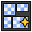

# Smart UV Project



Unwraps the mesh automatically, like **UV ▸ Smart UV Project** in Edit Mode: faces are projected
from a few directions and the islands are packed. As a modifier the UVs follow the mesh when you
change it, which is handy for generated meshes and for the modifiers above it.

Add it from **Add Modifier ▸ Edit**. It works on meshes. In the [Modifier List](MODIFIER_LIST.md)'s Add menu it's in the **UV** column.

## Settings

- **UV Map**: Name of the UV map to write. It is added when missing.
- **Angle Limit**: Faces whose normals differ by less than this are projected together.
- **Island Margin**: Space between the islands.
- **Rotate Islands**: Rotate the islands to pack them better.
- **Pack**: Fit the islands into the UV square. Without it they keep their real size.
- **Vertex Group**: Only unwrap faces whose points are all in this group.

## As a node

Geometry Nodes has a **Smart UV Project** node that shares its code with this modifier, so a node tree and the modifier give the same result.

## In Python

```python
mod = obj.modifiers.new("Smart UV Project", 'SMART_UV_PROJECT')
```

The Python type is `SmartUVProjectModifier`. Official Blender doesn't know this modifier, so a file that uses it won't give the same result there.
