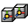

# Store Element Pivot



Writes the center and the axes of each island or other element to point attributes. Geometry Nodes,
shaders and other modifiers can then rotate, scale or move each element around its own center, or
read which element a point belongs to.

Add it from **Add Modifier ▸ Edit**. It works on meshes. In the [Modifier List](MODIFIER_LIST.md)'s Add menu it's in the **Elements** column.

## Settings

- **Element**: What counts as one element.
  - **Face**: Each face on its own.
  - **Island**: Each connected piece.
  - **UV Island**: Each UV island.
  - **Material**: All faces with the same material.
  - **Face Set**: Each face set from sculpt mode.
- **UV Map**: UV map for UV islands. The active one when empty.
- **Pivot**: Which point to store as the center.
  - **Center**: Average of the element's points.
  - **Bounds Center**: Center of the element's bounding box.
  - **Origin**: Origin of the object.
- **Center**: Point attribute for the center of the element. Empty to skip.
- **X Axis**: Point attribute for the X axis, along the longest edge. Empty to skip.
- **Z Axis**: Point attribute for the Z axis, the normal. Empty to skip.
- **Index**: Point attribute for the number of the element. Empty to skip.

## As a node

Geometry Nodes has a **Element Pivot** node that shares its code with this modifier, so a node tree and the modifier give the same result.

## In Python

```python
mod = obj.modifiers.new("Store Element Pivot", 'ELEMENT_PIVOT')
```

The Python type is `ElementPivotModifier`. Official Blender doesn't know this modifier, so a file that uses it won't give the same result there.
