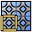

# Tile



Makes the mesh repeat without seams. Set the size of one tile; any part of the mesh that sticks out
past a side is cut off there and comes back in at the opposite side. Copies of the result placed
side by side line up, so you can model or sculpt a tileable floor, wall or ground and bake it to a
tileable texture.

Tile doesn't add anything new. It only cuts and moves the mesh you already have.

Add it from **Add Modifier ▸ Generate**. It works on meshes. In the
[Modifier List](MODIFIER_LIST.md)'s Add menu it's in the **Elements** column, next to Array.

## Settings

- **Size**: width and depth of the tile, along the object's X and Y.
- **Axes**: **X and Y** repeats in both directions. **X** or **Y** repeats in one direction only,
  for a band such as a border or a frieze.
- **Center**: an object whose location is the middle of the tile. Empty uses the object's origin.
- **Preview**: shows the eight neighboring tiles around it, so you can see the seams while you
  work. They're left out of renders and when you apply the modifier.
- **Merge**: joins the points where pieces brought in from both sides meet on a border.
  **Distance** sets how close they must be.

The mesh is cut along X and Y only. Height is left alone.

## In Python

```python
mod = obj.modifiers.new("Tile", 'TILE')
mod.size = (2.0, 2.0)
mod.axes = 'XY'
mod.show_preview = True
```
