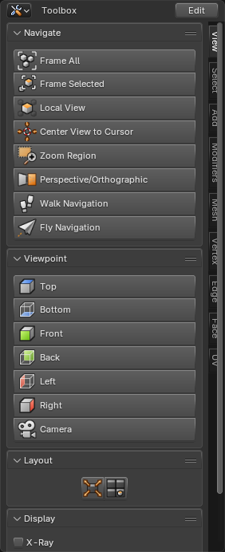

# Toolbox

A new editor with a column of large buttons in sections, and tabs down the right side. Fill it with
the operators, menus, tools and settings you use most, and keep it open next to the 3D Viewport.
Choose **Toolbox** from any area's Editor Type menu.

## Default tabs

It starts with these tabs, so it's useful right away:

| Tab | Sections |
|---|---|
| View | Navigate, Viewpoint, Layout, Display |
| Select | Basic, Grow, Loops, Special |
| Add | Mesh, Curve, Surface, Metaball, Other, Empty, Light & Camera, Force Field, Draw Tools, Duplicate |
| Modifiers | Common, Generate, Deform, Edit, Normals, Physics, Manage |
| Mesh | Tools, Commands, Clean Up, Normals |
| Vertex | Tools, Commands, Merge, Options |
| Edge | Tools, Commands, Marks |
| Face | Tools, Create, Modify |
| UV | Unwrap, Seams |

## Adding buttons

Right-click any button, menu or setting in Blender and choose **Add to Toolbox**. It goes into the
section you pick. A toolbar tool becomes a button that switches to that tool, and a setting becomes
a switch or a field.

## Arranging

Everything is in the right-click menu of the Toolbox:

- **Buttons:** move them, move them to another section, rename them, change their icon, add a
  separator, or remove them with **Remove from Toolbox**.
- **Sections:** add, rename, move and remove them. **Toggle Icons/List** switches a section between a
  grid of icons and a list with one named button per row.
- **Tabs:** add, rename, move and remove them.
- **Restore Default Tab** brings back a default tab as it was, and **Reset Toolbox to Default** brings
  back all of them.

## Saving

The contents are saved in `toolbox.json` in your user settings, so they're the same in every file
and in every Toolbox editor.
